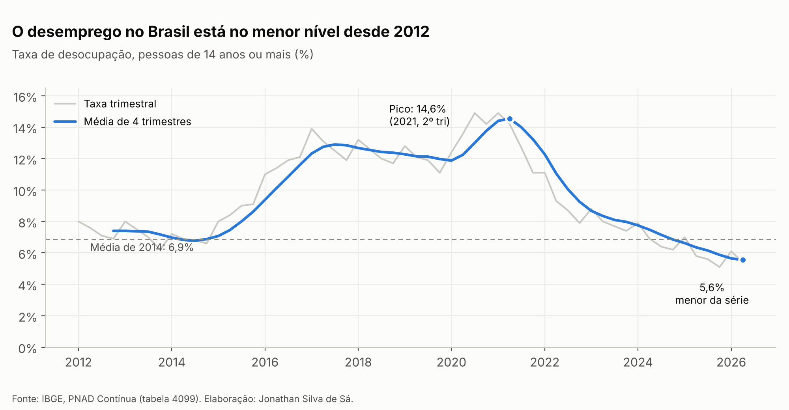
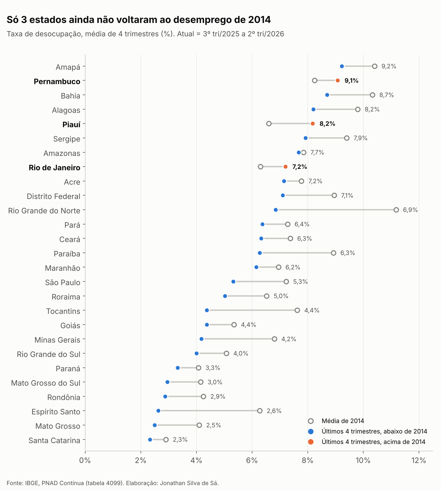
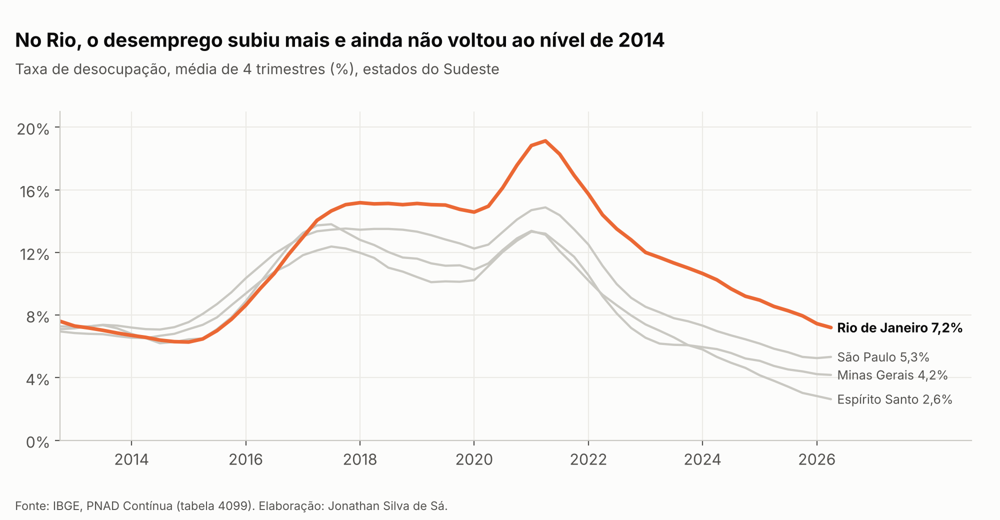
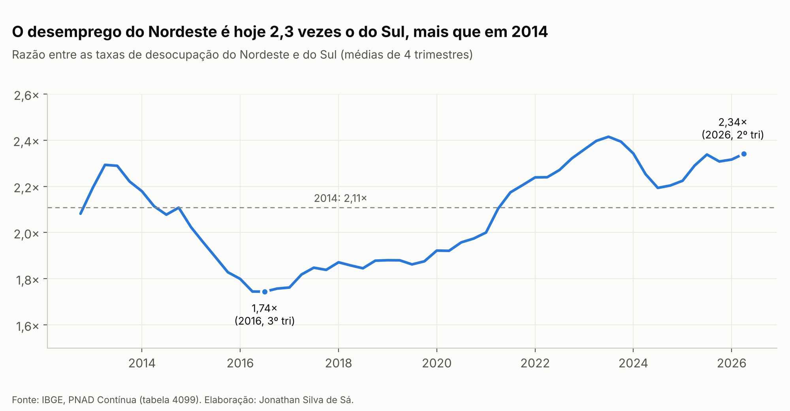

# 📉 O desemprego caiu em todos os estados?

> Análise da taxa de desocupação da PNAD Contínua (IBGE) por estado, de 2012 a 2026, com pandas e matplotlib.


O Brasil chegou ao menor desemprego da série histórica. A pergunta é se essa recuperação chegou a todos os estados.

## Principais achados

- **O Brasil está no menor nível da série:** 5,6% na média dos últimos 4 trimestres (3º tri/2025 a 2º tri/2026), contra 14,6% no pico de 2021 e 6,9% em 2014.
- **A recuperação foi ampla:** 24 das 27 UFs estão abaixo do desemprego de 2014, e 18 estão no menor nível da própria série.
- **Três estados ainda não voltaram ao nível de 2014:** Piauí, Rio de Janeiro e Pernambuco.
- **O Rio de Janeiro foi do 19º para o 8º maior desemprego do país.** Subiu mais que os vizinhos do Sudeste (pico de 19,1% em 2021) e ainda está acima dos 6,3% de 2014.
- **A distância relativa entre Nordeste e Sul aumentou:** o desemprego do Nordeste é hoje 2,34 vezes o do Sul, contra 2,11 vezes em 2014.

---



Depois de quase dobrar na recessão de 2015–2016 e subir de novo na pandemia, o desemprego caiu sem interrupção desde 2021 e ficou abaixo do nível de 2014.



Cada linha liga a média de 2014 (círculo vazio) à média dos últimos 4 trimestres (círculo cheio). Em laranja, os três estados que ainda estão acima do nível de 2014.



Em 2014 o Rio tinha desemprego parecido com o dos vizinhos. A partir de 2017 descolou para cima e, apesar da queda desde 2021, segue como a maior taxa do Sudeste.



Em pontos percentuais, a diferença entre Nordeste e Sul é parecida com a de 2014 (cerca de 4,5 p.p.). Como o Sul caiu para pouco mais de 3%, a razão entre os dois subiu.

---

## Método

- **Dados:** taxa de desocupação trimestral da PNAD Contínua, [tabela 4099 do SIDRA](https://sidra.ibge.gov.br/tabela/4099), pessoas de 14 anos ou mais. Brasil, 5 regiões e 27 UFs, do 1º tri/2012 ao 2º tri/2026.
- **Sazonalidade:** o 1º trimestre fica, em média, 0,6 ponto acima da média do ano e o 4º trimestre, 0,6 abaixo. Para não confundir época do ano com tendência, as comparações usam a **média móvel de 4 trimestres**.
- **Referência pré-crise:** média de 2014, último ano antes da recessão de 2015–2016.

## Limitações

- A PNAD Contínua é amostral. Em estados menores (Amapá, Roraima, Acre), diferenças de cerca de 1 ponto podem estar dentro da margem de erro.
- A taxa de desocupação não capta informalidade, subocupação nem desalento.
- A análise descreve o que aconteceu. As causas citadas para o Rio de Janeiro são contexto, não foram testadas com estes dados.

---

## ▶️ Como reproduzir

```bash
git clone https://github.com/jonathansilvadesa-sys/analise-desemprego-uf && cd analise-desemprego-uf
pip install -r requirements.txt
jupyter notebook notebooks/analise_desemprego_uf.ipynb
```

Para atualizar os dados com o trimestre mais recente: `python scripts/baixar_dados.py`.

## 📁 Estrutura

```
analise-desemprego-uf/
├── data/desocupacao_trimestral.csv      # série baixada da API do IBGE
├── scripts/baixar_dados.py              # download e preparação do CSV
├── notebooks/analise_desemprego_uf.ipynb
├── img/                                 # gráficos gerados pelo notebook
└── requirements.txt
```

O mesmo dado também é extraído, validado e carregado em modelo estrela no projeto [etl-pipeline-dados-abertos](https://github.com/jonathansilvadesa-sys/etl-pipeline-dados-abertos).

---

## 📬 Contato

**Jonathan Silva de Sá** · [LinkedIn](https://linkedin.com/in/jonathan-de-sa) · jonathansilvadesa@gmail.com
